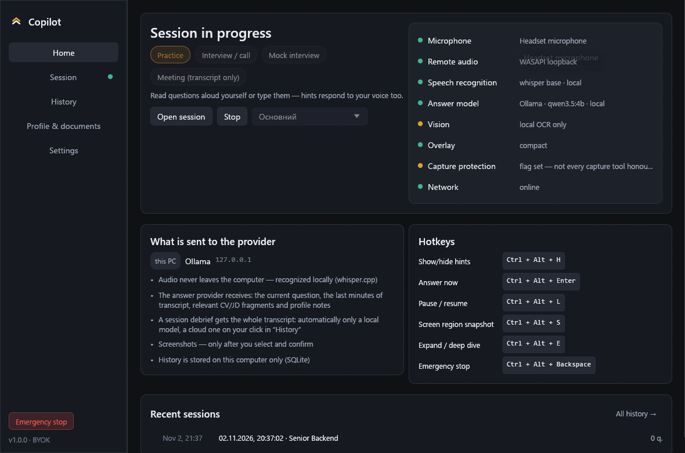
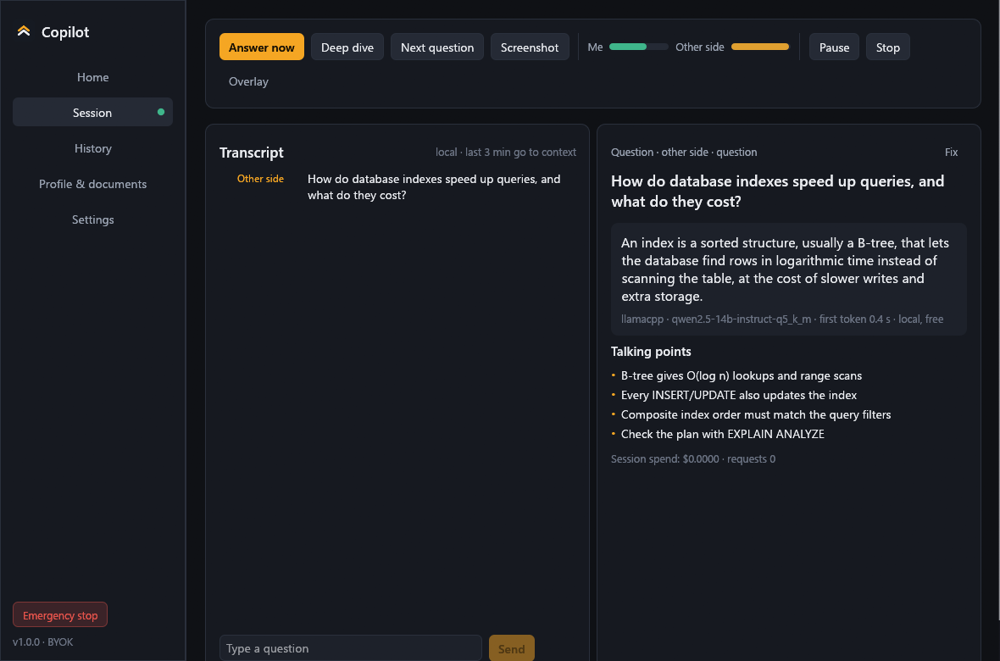
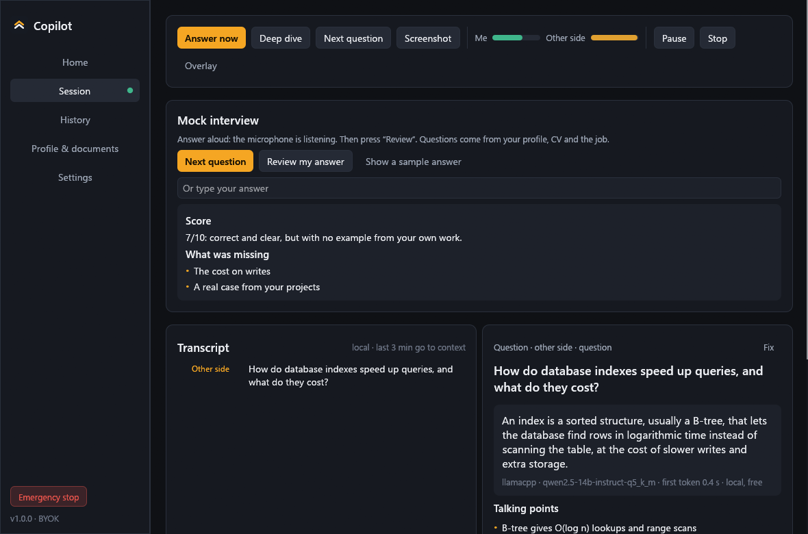
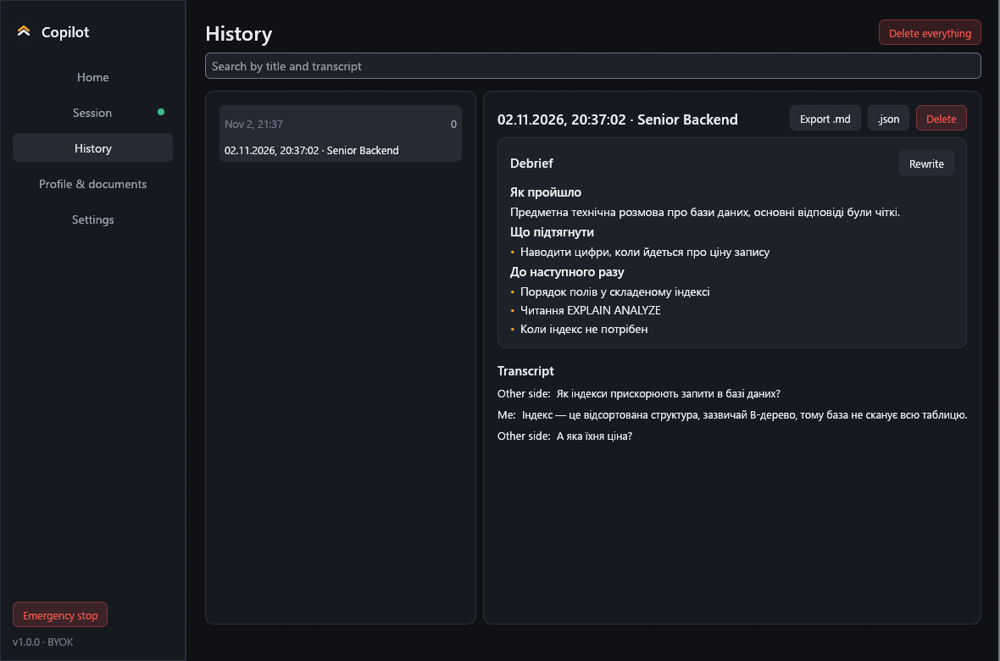
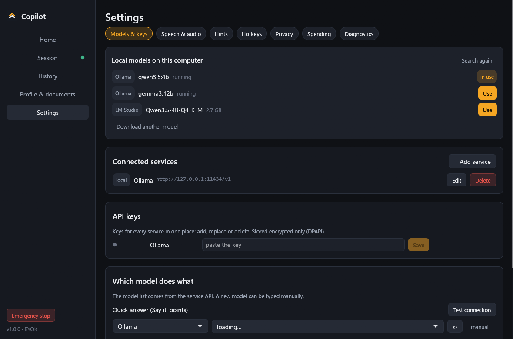

# Copilot

**A real-time interview and meeting assistant that runs on your own computer.** It listens to the call, spots the question, and shows a short answer built from your CV. Speech recognition is local. There is no account, no subscription and no server of ours.

[](https://github.com/Galactic717/copilot-rust/actions/workflows/ci.yml)
[](https://github.com/Galactic717/copilot-rust/releases/latest)
[](LICENSE)

[Українською](README.uk.md) · [Download](#download) · [Features](#features) · [Local models](#local-models) · [Privacy](#privacy) · [Build](#build-from-source)



## Download

**[Copilot-windows-x64.exe](https://github.com/Galactic717/copilot-rust/releases/latest)**: one file, about 190 MB, nothing to install. Download it and run it. Speech recognition, the voice detector and the local model server are all inside, so it works offline from the first launch. Windows 10 2004 or newer.

The same page has a `-lite` edition (about 30 MB) that fetches those components when first needed.

The exe is not code-signed yet, so Windows SmartScreen shows "Windows protected your PC" the first time: click **More info → Run anyway**. Every release lists SHA-256 checksums in `SHA256SUMS.txt`.

## Features

**Before the call**
- **Mock interview.** The app asks questions drawn from your CV and the job description, you answer aloud, and it scores the answer and writes a stronger version.
- **Your facts only.** Upload a CV, job description or notes (PDF, DOCX, TXT, MD). Answers about your experience use only those; a claim with no source is marked `[not in CV]` instead of being invented.

**During the call**
- **Small overlay** that never takes keyboard focus, sizes itself to the answer, and has adjustable transparency.
- **Question detection** in 12 languages, with a short "say this" answer, talking points, and a deep dive on demand.
- **Screen region snapshot** for coding tasks: a vision model reads it, or Windows OCR if the model has no vision. You can paint over private data first.
- **Live translation** of each question into your language, for interviews in a foreign one.
- **Global hotkeys** and an emergency stop that cuts capture instantly.

**After the call**
- **Debrief:** how it went, questions asked, gaps to close, what to prepare. For a meeting: summary, decisions, action items.
- **Searchable history** with Markdown and JSON export, plus crash recovery and session resume.

**Everywhere**
- **Finds local LLMs on its own** (see below), or takes your key for OpenAI, Anthropic, Gemini, OpenRouter, Groq, DeepSeek, Mistral, xAI, Together, Fireworks, Cerebras or any OpenAI-compatible server.
- **Interface in 12 languages:** English, Ukrainian, German, Spanish, French, Italian, Portuguese, Polish, Turkish, Chinese, Japanese, Korean.
- **Speech and answers in 47 languages**, or mixed with auto-detection.
- **Spending limits** per session and per day, with live cost tracking.
- **Updates itself** after you confirm, with the download verified by SHA-256.

| | |
|---|---|
|  |  |
|  |  |

## Why this exists

Most interview copilots are cloud services on a monthly subscription, commonly $25 to $150, and many cap your minutes. This one runs on hardware you already own:

- **One file, not an installer and an account.** Speech never leaves your computer.
- **No caps.** With a local model every answer is free. With your own key you pay the provider's price and nothing on top.
- **No lock-in.** History is a SQLite file on your disk, and the code is open.

## Local models

If you already run a local LLM, there is nothing to set up. On start the app looks for:

| What it finds | How |
|---|---|
| Running servers | Ollama, LM Studio, Jan, GPT4All, llama.cpp, KoboldCpp, text-generation-webui, vLLM, LiteLLM, Cortex, Msty, checked on their default ports on loopback only |
| Installed but stopped | Ollama: the app starts it when needed |
| Model files | GGUF from LM Studio, Hugging Face, Jan, GPT4All, Ollama, `~/models` and `Downloads`. The built-in llama-server runs them, so the app that downloaded them does not need to be open |

Click **Use** and it is connected. Embedding models and projectors are skipped, and a model too big for your RAM is flagged. If nothing is found, one click downloads a recommended multilingual model (Qwen 3.5, Apache 2.0, 1.3 or 2.7 GB) with resume and checksum verification.

## Privacy

- **Audio never leaves the computer** and is never written to disk.
- **No telemetry.** The one request the app makes on its own is the update check on GitHub, which you can turn off.
- **API keys** are encrypted by Windows (DPAPI) and kept out of settings, logs and exports.
- **Offline mode** blocks every external address in the app itself, redirects included.
- **You see what is sent:** the Home screen lists what goes to which provider.

Details in [PRIVACY.md](PRIVACY.md).

## Use it honestly

Recording a conversation and using AI assistance is only appropriate where the rules allow it and the participants agree, and the law on recording varies by country. The app can set a Windows flag that asks capture tools to leave its windows out, but no tool is obliged to honor it: treat it as a tidiness feature for screen sharing, not as a promise of invisibility. Copilot does not try to defeat proctoring or monitoring software. Checking what is allowed is your responsibility.

## Hotkeys

| | |
|---|---|
| Show or hide hints | `Ctrl+Alt+H` |
| Answer now | `Ctrl+Alt+Enter` |
| Pause or resume | `Ctrl+Alt+L` |
| Screen region snapshot | `Ctrl+Alt+S` |
| Deep dive | `Ctrl+Alt+E` |
| Emergency stop | `Ctrl+Alt+Backspace` |

All of them can be changed in Settings.

## Build from source

Needs a stable Rust toolchain and the MSVC build tools.

```powershell
cargo test
cargo run                        # development
cargo build --release            # target\release\Copilot.exe
python scripts\package.py        # dist\: the one-file edition, the lite edition, checksums
```

- Data lives in `%APPDATA%\copilot`. `COPILOT_DATA_DIR` points a test instance elsewhere.
- `COPILOT_SNAPSHOT=<dir>` renders every screen to PNG with the windows hidden, then exits. `COPILOT_SNAPSHOT_LANGS=de,ja` picks the languages.
- Live checks against real binaries: `COPILOT_ASR_DIR=<dir> COPILOT_TEST_WAV=<16 kHz wav> cargo test live_whisper -- --ignored` and `COPILOT_TEST_DIR=<dir> cargo test live_llama -- --ignored`.

See [CONTRIBUTING.md](CONTRIBUTING.md), including how to add a language.

## Credits

Copilot began as [Magerko/copilot](https://github.com/Magerko/copilot) (MIT), rewritten in Rust and extended here. It stands on [whisper.cpp](https://github.com/ggml-org/whisper.cpp), [llama.cpp](https://github.com/ggml-org/llama.cpp), [Silero VAD](https://github.com/snakers4/silero-vad) and [egui](https://github.com/emilk/egui); the full list is in [THIRD-PARTY-NOTICES.md](THIRD-PARTY-NOTICES.md).

"Copilot" here is a descriptive name. This project is not affiliated with Microsoft or GitHub.

## License

[MIT](LICENSE). Questions and bug reports go to [Issues](https://github.com/Galactic717/copilot-rust/issues); **Settings → Diagnostics → Save a report for support** produces a report with no keys and no conversation text.
