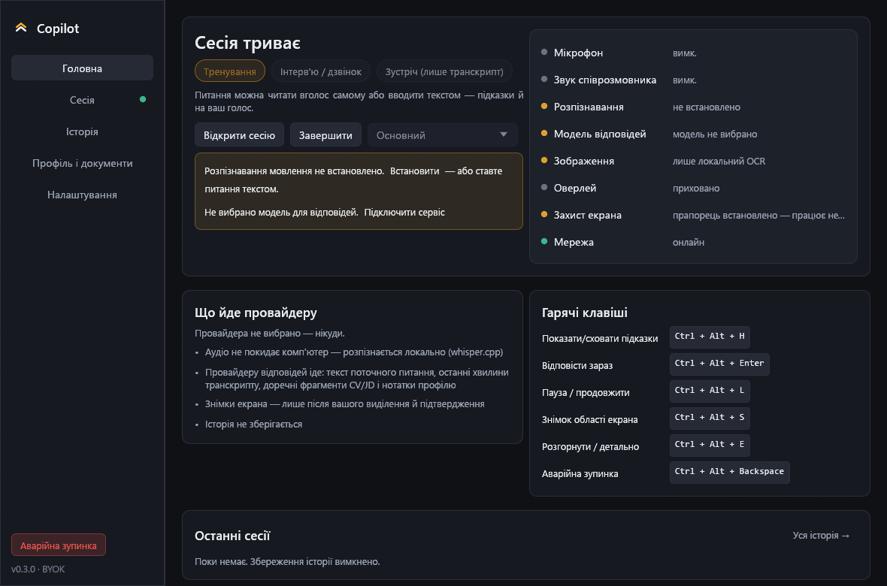
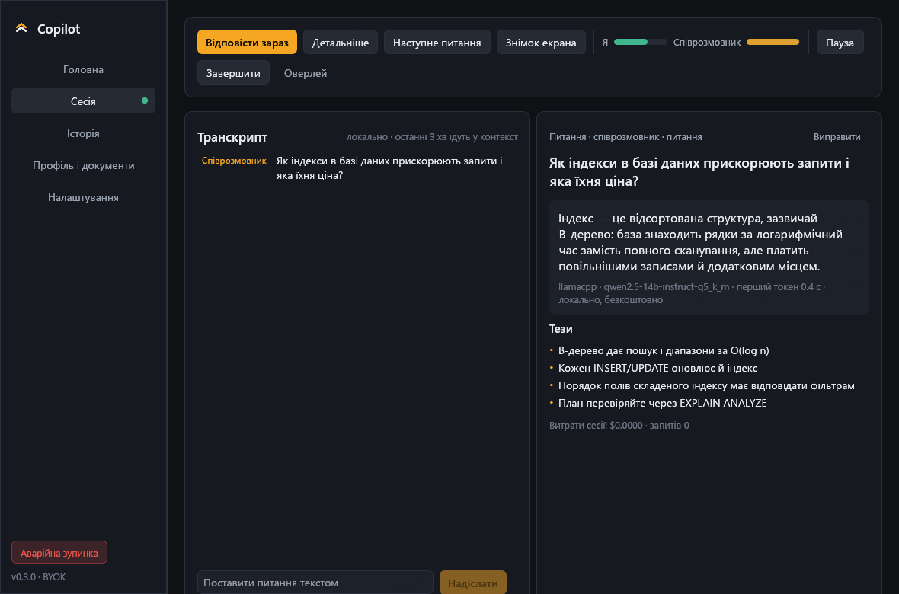
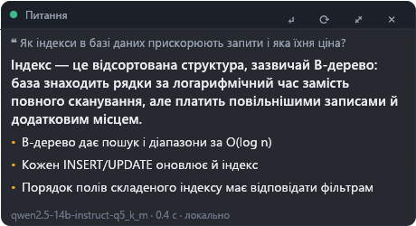
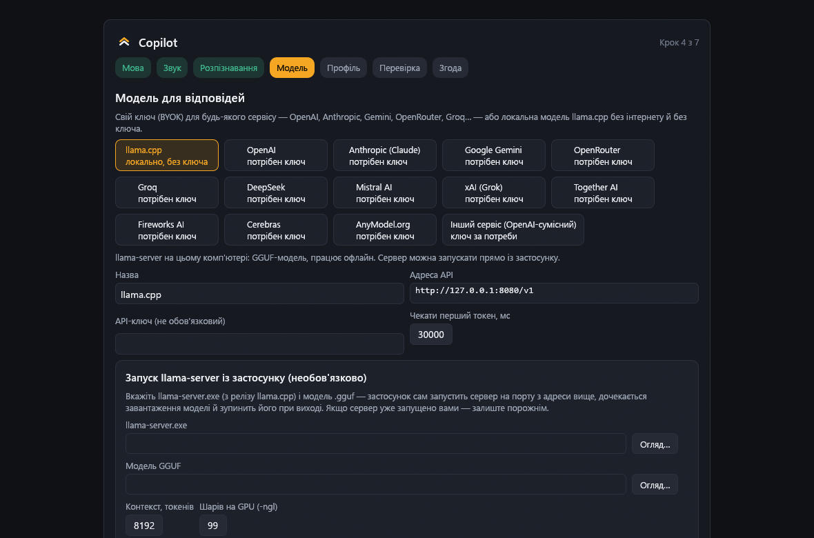
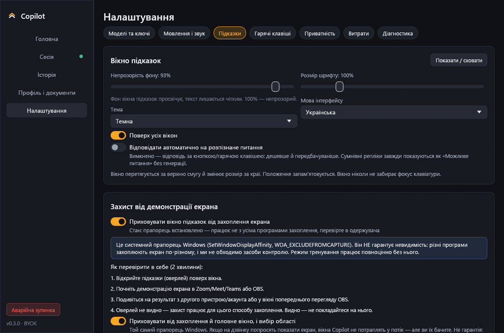

# Copilot

[](https://github.com/Magerko/copilot/actions/workflows/ci.yml)

Слухає розмову, розпізнає мовлення локально, помічає питання й показує коротку відповідь
у невеликому оверлеї — з опорою на завантажені документи. Windows. Написано на Rust.

[English below](#english)

## Можливості
- Інтерфейс українською та англійською.
- Локальне розпізнавання мовлення (whisper.cpp) з Silero VAD: аудіо не йде в мережу й не пишеться на диск.
- Модель відповідей на вибір — один каталог для всіх сервісів:
  локально через **llama.cpp** (застосунок сам запускає `llama-server` з GGUF-моделлю) або за вашим ключем:
  OpenAI, Anthropic, Gemini, **OpenRouter**, Groq, DeepSeek, Mistral, xAI, Together, Fireworks, Cerebras, AnyModel
  чи будь-який OpenAI-сумісний сервер. Усі ключі — в одному розділі «Ключі API», зашифровані DPAPI.
- Відповіді спираються лише на завантажені документи (PDF/DOCX/TXT/MD); чого немає — позначається `[немає в резюме]`.
- Знімок виділеної області екрана → vision-модель або вбудований OCR Windows.
- Оверлей не забирає фокус, підлаштовує висоту, має регульовану прозорість фону.
- Вікна можна виключити із захоплення екрана (прапорець Windows `WDA_EXCLUDEFROMCAPTURE`; підтримується не всіма програмами захоплення).
- Трей, глобальні гарячі клавіші, аварійна зупинка, продовження минулої сесії, історія в SQLite з експортом у Markdown/JSON.
- Облік витрат і ліміти. Офлайн-режим блокує зовнішні виклики.
- Без акаунта й власного сервера.

## Скриншоти


| Сесія | Оверлей |
|---|---|
|  |  |

| Вибір моделі | Налаштування підказок |
|---|---|
|  |  |

## Перший запуск
1. Мова → звук (мікрофон і системний звук) → розпізнавання (завантаження ≈ 160 МБ, перевірка SHA-256).
2. Модель: llama.cpp (шлях до `llama-server.exe` і `.gguf`) або сервіс із ключем.
3. Профіль і документи.

## Гарячі клавіші
| | |
|---|---|
| Показати / сховати підказки | `Ctrl+Alt+H` |
| Відповісти зараз | `Ctrl+Alt+Enter` |
| Пауза / продовжити | `Ctrl+Alt+L` |
| Знімок області екрана | `Ctrl+Alt+S` |
| Детальніше | `Ctrl+Alt+E` |
| Аварійна зупинка | `Ctrl+Alt+Backspace` |

## Для розробників
```powershell
cargo test
cargo run                    # розробка
cargo build --release        # target\release\Copilot.exe (+ DirectML.dll поруч)
```
- Дані: `%APPDATA%\copilot` (settings.json, providers.json, keys.dpapi.json, kairos.db, asr\). Інша тека — `COPILOT_DATA_DIR`.
- `COPILOT_SNAPSHOT=<тека>` рендерить усі екрани у PNG без показу вікон і завершується.
- Живий тест розпізнавання: `COPILOT_ASR_DIR=<тека> COPILOT_TEST_WAV=<16 кГц wav> cargo test live_whisper -- --ignored`.

---

## English

Listens to a conversation, recognizes speech locally, spots questions and shows a short answer in a small
overlay, grounded in your documents. Windows. Written in Rust.

- UI in Ukrainian and English.
- Local speech recognition (whisper.cpp) gated by Silero VAD: audio never leaves the machine.
- One catalog for every answer model: local **llama.cpp** (the app can start `llama-server` with a GGUF model) or
  your own key for OpenAI, Anthropic, Gemini, **OpenRouter**, Groq, DeepSeek, Mistral, xAI, Together, Fireworks,
  Cerebras, AnyModel or any OpenAI-compatible server. All keys live in one “API keys” section, encrypted with DPAPI.
- Answers use only your documents; missing facts are marked `[not in CV]`.
- Screen-region snapshot → vision model or the built-in Windows OCR.
- Focus-less overlay, capture exclusion flag, tray, global hotkeys, emergency stop, session resume,
  SQLite history with Markdown/JSON export, spend limits, offline mode. No account, no server.

## Контакти / Contacts
- Telegram: [@magerdev1](https://t.me/magerdev1)
- GitHub: <https://github.com/Magerko/copilot>
