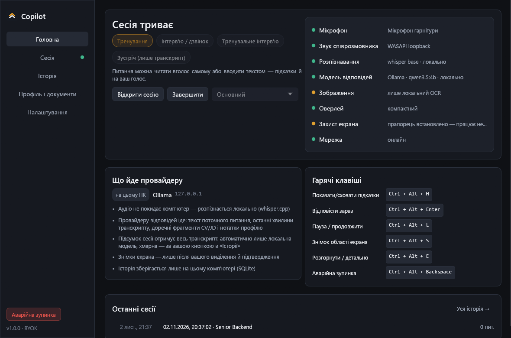
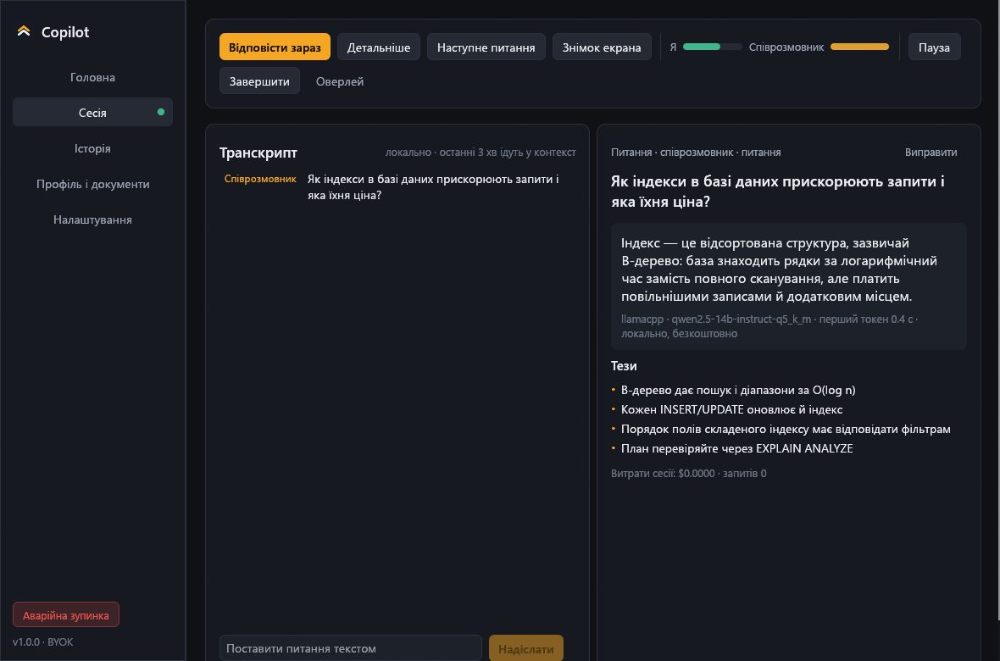
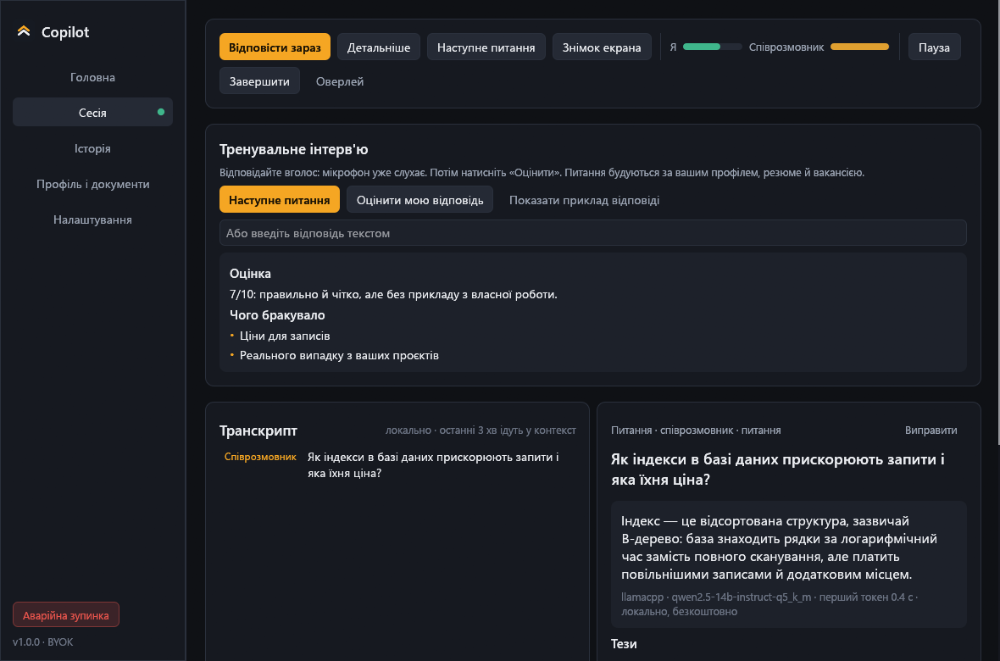
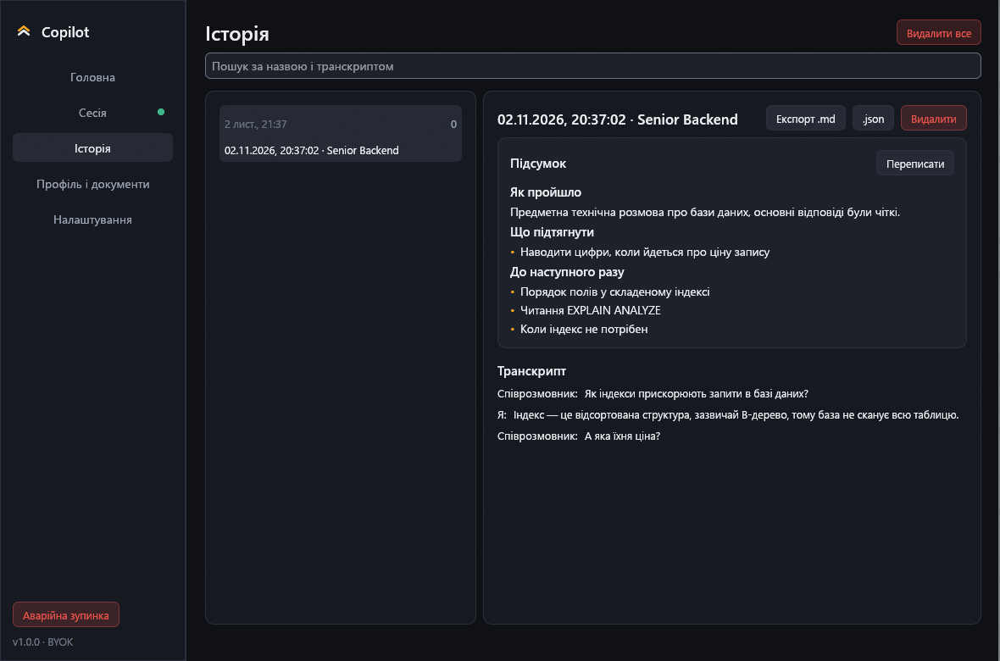
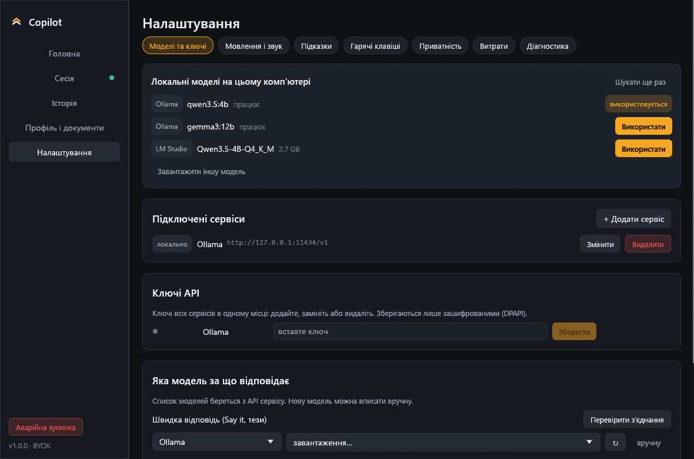

# Copilot

**Помічник для співбесід і зустрічей у реальному часі, що працює на вашому комп'ютері.** Слухає дзвінок, помічає питання й показує коротку відповідь на основі вашого резюме. Розпізнавання мовлення локальне. Немає ні акаунта, ні підписки, ні нашого сервера.

[](https://github.com/Galactic717/copilot-rust/actions/workflows/ci.yml)
[](https://github.com/Galactic717/copilot-rust/releases/latest)
[](LICENSE)

[English](README.md) · [Завантажити](#завантажити) · [Можливості](#можливості) · [Локальні моделі](#локальні-моделі) · [Приватність](#приватність) · [Збірка](#збірка-з-коду)



## Завантажити

**[Copilot-windows-x64.exe](https://github.com/Galactic717/copilot-rust/releases/latest)**: один файл близько 190 МБ, нічого встановлювати не треба. Завантажте й запустіть. Розпізнавання мовлення, детектор голосу й сервер локальних моделей уже всередині, тому застосунок працює офлайн із першого запуску. Потрібна Windows 10 2004 або новіша.

На тій самій сторінці є версія `-lite` (близько 30 МБ), яка завантажує ці компоненти, коли вони вперше знадобляться.

Файл поки не підписаний сертифікатом, тому під час першого запуску Windows SmartScreen покаже попередження: натисніть **Докладніше → Однаково запустити**. Контрольні суми SHA-256 кожного релізу лежать у `SHA256SUMS.txt`.

## Можливості

**Перед дзвінком**
- **Тренувальне інтерв'ю.** Застосунок ставить питання за вашим резюме й вакансією, ви відповідаєте вголос, а він оцінює відповідь і пише сильнішу версію.
- **Лише ваші факти.** Завантажте резюме, вакансію чи нотатки (PDF, DOCX, TXT, MD). Відповіді про ваш досвід спираються тільки на них; твердження без джерела позначається `[немає в резюме]`, а не вигадується.

**Під час дзвінка**
- **Маленький оверлей**, який ніколи не забирає фокус клавіатури, підлаштовується під відповідь і має регульовану прозорість.
- **Розпізнавання питань** 12 мовами: коротка відповідь «скажи це», тези й детальний розбір за запитом.
- **Знімок області екрана** для задач із кодом: його читає vision-модель або OCR Windows, якщо модель не вміє зображень. Приватні дані можна спершу замалювати.
- **Переклад питань наживо** вашою мовою для співбесід іноземною.
- **Глобальні гарячі клавіші** й аварійна зупинка, що миттєво глушить захоплення.

**Після дзвінка**
- **Підсумок:** як пройшло, які були питання, що підтягнути, до чого готуватися. Для зустрічі: резюме, рішення, завдання.
- **Історія з пошуком** і експортом у Markdown та JSON, відновлення після збою й продовження сесії.

**Завжди**
- **Сам знаходить локальні LLM** (див. нижче) або працює з вашим ключем OpenAI, Anthropic, Gemini, OpenRouter, Groq, DeepSeek, Mistral, xAI, Together, Fireworks, Cerebras чи будь-якого OpenAI-сумісного сервера.
- **Інтерфейс 12 мовами:** українська, англійська, німецька, іспанська, французька, італійська, португальська, польська, турецька, китайська, японська, корейська.
- **Мовлення й відповіді 47 мовами** або змішано з автовизначенням.
- **Ліміти витрат** на сесію й на день, облік у реальному часі.
- **Оновлюється сам** після вашого підтвердження, завантаження перевіряється за SHA-256.

| | |
|---|---|
|  |  |
|  |  |

## Навіщо це

Більшість таких помічників — хмарні сервіси з місячною підпискою, зазвичай від $25 до $150, і часто з лімітом хвилин. Цей працює на залізі, яке у вас уже є:

- **Один файл, а не інсталятор з акаунтом.** Мовлення не покидає комп'ютер.
- **Без лімітів.** З локальною моделлю кожна відповідь безкоштовна. З власним ключем ви платите ціну провайдера й нічого зверху.
- **Без прив'язки.** Історія — це файл SQLite на вашому диску, а код відкритий.

## Локальні моделі

Якщо у вас уже є локальна LLM, налаштовувати нічого не треба. Під час запуску застосунок шукає:

| Що знаходить | Як |
|---|---|
| Запущені сервери | Ollama, LM Studio, Jan, GPT4All, llama.cpp, KoboldCpp, text-generation-webui, vLLM, LiteLLM, Cortex, Msty на їхніх типових портах, лише на цьому комп'ютері |
| Встановлені, але зупинені | Ollama: застосунок запустить її, коли потрібно |
| Файли моделей | GGUF з LM Studio, Hugging Face, Jan, GPT4All, Ollama, `~/models` і `Downloads`. Їх запускає вбудований llama-server, тож застосунок, який їх завантажив, може бути закритим |

Натисніть **Використати**, і модель підключено. Моделі ембедингів і проєктори пропускаються, а завелика для вашої пам'яті модель позначається. Якщо нічого не знайдено, одним кліком завантажується рекомендована багатомовна модель (Qwen 3.5, Apache 2.0, 1.3 або 2.7 ГБ) із докачуванням і перевіркою контрольної суми.

## Приватність

- **Аудіо не покидає комп'ютер** і не пишеться на диск.
- **Телеметрії немає.** Єдиний запит із власної ініціативи — перевірка оновлень на GitHub, її можна вимкнути.
- **Ключі API** шифрує Windows (DPAPI), вони не потрапляють у налаштування, журнали й експорт.
- **Офлайн-режим** блокує всі зовнішні адреси на рівні застосунку, зокрема й редиректи.
- **Видно, що надсилається:** на головному екрані показано, що й кому йде.

Докладно в [PRIVACY.md](PRIVACY.md).

## Використовуйте чесно

Записувати розмову й користуватися AI-підказками доречно лише там, де це дозволяють правила й погоджуються учасники, а закони про запис різняться залежно від країни. Застосунок може встановити прапорець Windows, що просить програми захоплення не показувати його вікна, але жодна програма не зобов'язана його враховувати: це зручність під час демонстрації екрана, а не обіцянка невидимості. Copilot не намагається обійти прокторинг чи засоби контролю. Перевірити, що дозволено, — ваша відповідальність.

## Гарячі клавіші

| | |
|---|---|
| Показати або сховати підказки | `Ctrl+Alt+H` |
| Відповісти зараз | `Ctrl+Alt+Enter` |
| Пауза або продовжити | `Ctrl+Alt+L` |
| Знімок області екрана | `Ctrl+Alt+S` |
| Детальніше | `Ctrl+Alt+E` |
| Аварійна зупинка | `Ctrl+Alt+Backspace` |

Усі можна змінити в налаштуваннях.

## Збірка з коду

Потрібні стабільний Rust і MSVC build tools.

```powershell
cargo test
cargo run                        # розробка
cargo build --release            # target\release\Copilot.exe
python scripts\package.py        # dist\: один файл, lite-версія, контрольні суми
```

- Дані лежать у `%APPDATA%\copilot`. `COPILOT_DATA_DIR` перенаправляє тестовий екземпляр в іншу теку.
- `COPILOT_SNAPSHOT=<тека>` рендерить усі екрани у PNG без показу вікон і завершується. `COPILOT_SNAPSHOT_LANGS=de,ja` вибирає мови.
- Живі перевірки зі справжніми бінарниками: `COPILOT_ASR_DIR=<тека> COPILOT_TEST_WAV=<wav 16 кГц> cargo test live_whisper -- --ignored` і `COPILOT_TEST_DIR=<тека> cargo test live_llama -- --ignored`.

Див. [CONTRIBUTING.md](CONTRIBUTING.md), зокрема як додати мову.

## Подяки

Copilot почався як [Magerko/copilot](https://github.com/Magerko/copilot) (MIT), тут переписаний на Rust і розширений. Він стоїть на [whisper.cpp](https://github.com/ggml-org/whisper.cpp), [llama.cpp](https://github.com/ggml-org/llama.cpp), [Silero VAD](https://github.com/snakers4/silero-vad) та [egui](https://github.com/emilk/egui); повний список у [THIRD-PARTY-NOTICES.md](THIRD-PARTY-NOTICES.md).

«Copilot» тут — описова назва. Проєкт не пов'язаний із Microsoft чи GitHub.

## Ліцензія

[MIT](LICENSE). Питання й повідомлення про помилки — в [Issues](https://github.com/Galactic717/copilot-rust/issues); **Налаштування → Діагностика → Зберегти звіт для підтримки** створює звіт без ключів і текстів розмов.
